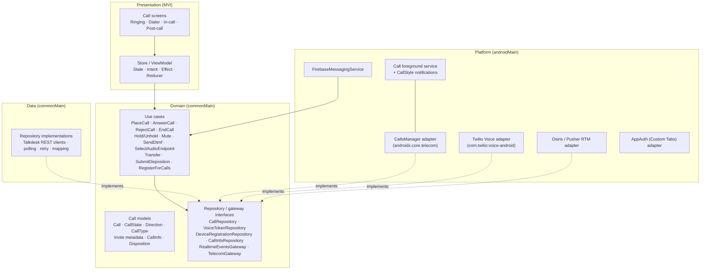
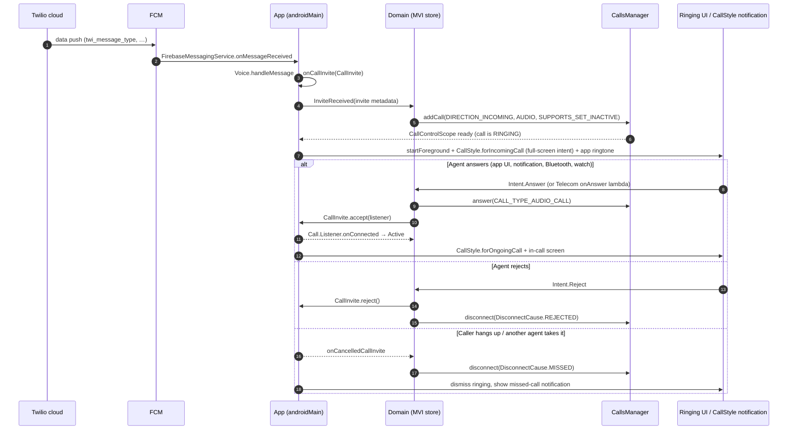
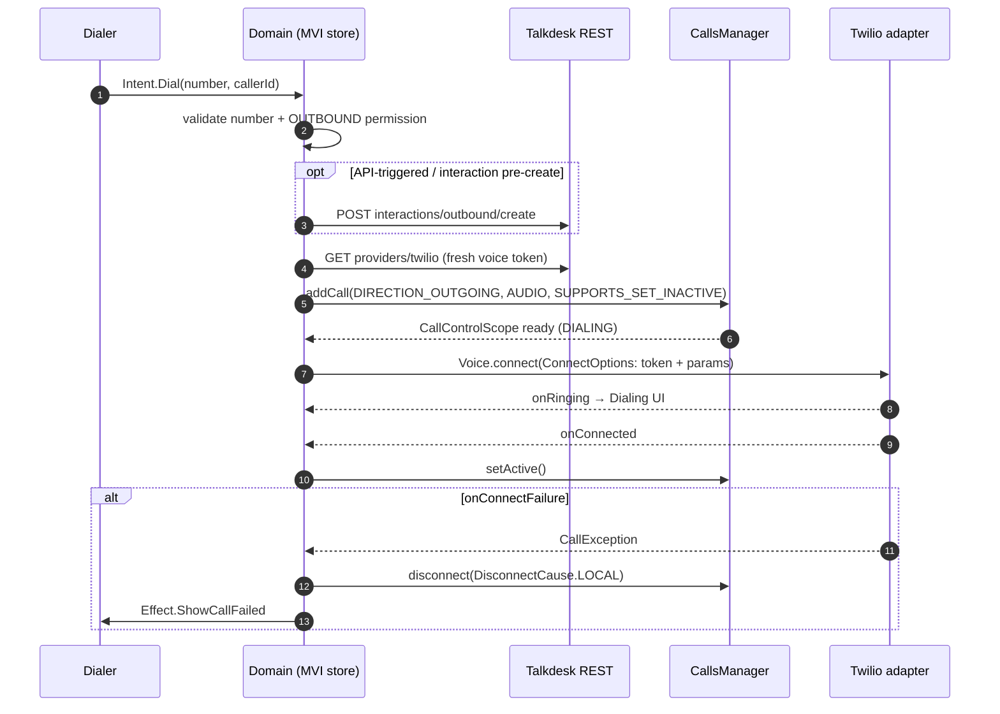
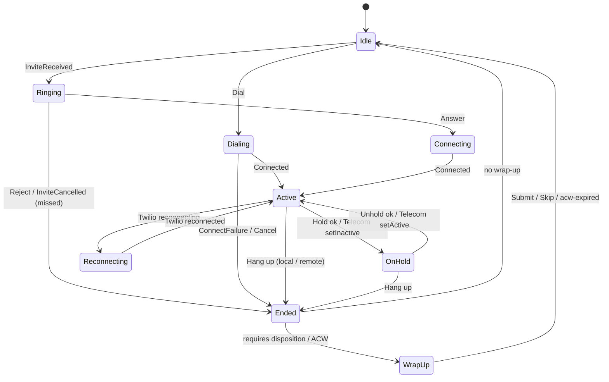

# Migration Guide: Calling (VoIP) from the Legacy Android App to the New KMP App

**Created**: 2026-11-13
**Status**: Draft — guidance for the new-app team
**Owner**: Talkdesk Mobile Team
**Scope**: Android only. Covers **all calling functionality** (inbound, outbound, in-call controls, audio routing, transfers, A2A, E911, post-call) when moving from this repository (`agent-mobile-android`) to the new Kotlin Multiplatform (KMP) app built with MVI + clean architecture on Jetpack **Core-Telecom** (`androidx.core.telecom.CallsManager`).

> **Out of scope:** iOS (ignored entirely), non-calling features (chat, SMS, WhatsApp, e-mail, settings, onboarding) unless they are a prerequisite for calling (authentication, regional configuration, agent profile), backend/Twilio/Firebase console changes, and any real secret values. This guide stays at the "what to call, what to carry over, how the pieces fit" level. It does not walk through legacy classes line by line. For that detail, follow the links to the existing design docs.

## Table of Contents

1. [TL;DR](#1-tldr)
2. [Legacy baseline (what exists today)](#2-legacy-baseline-what-exists-today)
3. [Target architecture in the new app](#3-target-architecture-in-the-new-app)
4. [Backend APIs and services used by calling](#4-backend-apis-and-services-used-by-calling)
5. [How VoIP calling works in the new app (CallsManager + Twilio)](#5-how-voip-calling-works-in-the-new-app-callsmanager--twilio)
6. [Working with the Twilio Voice Android SDK](#6-working-with-the-twilio-voice-android-sdk)
7. [What to copy / keep from the old app](#7-what-to-copy--keep-from-the-old-app)
8. [Legacy → new concept mapping](#8-legacy--new-concept-mapping)
9. [KMP source-set placement guide](#9-kmp-source-set-placement-guide)
10. [Step-by-step migration plan](#10-step-by-step-migration-plan)
11. [Risks and gotchas](#11-risks-and-gotchas)
12. [Open questions](#12-open-questions)
13. [References](#13-references)

---

## 1. TL;DR

- **Keep the identity.** Ship the new app under the **same applicationIds** (`com.talkdesk.agent` for production/release-candidate, `com.talkdesk.agent.qa`, `com.talkdesk.agent.stg`), the **same signing keys**, the **same Firebase projects** (`google-services.json`) and the **same OAuth redirect schemes**. Then FCM, Twilio push, device registrations and the Play listing keep working, and agents get an update instead of a new app.
- **Keep the media/signalling stack.** Twilio Voice Android SDK (`com.twilio:voice-android`, 6.x) stays the media engine. FCM stays the wake-up channel for incoming calls.
- **Replace the platform integration.** Drop the hand-written self-managed `ConnectionService` + `PhoneAccount` + `TelecomManager` code and Twilio AudioSwitch. Use **`CallsManager`** (`androidx.core:core-telecom`) for call registration, call state, remote-surface control (Bluetooth, watches, Auto) and audio endpoints.
- **Replace the architecture.** Legacy `StateMachine<T>`/`State<T>` managers + MVP presenters + RxJava become MVI (`State` / `Intent` / `Effect`) on coroutines/Flow. Domain use cases and data repositories go in `commonMain`. Everything that touches Android, Twilio, Firebase or Telecom goes in `androidMain`.
- **Keep the backend contract.** The Talkdesk REST endpoints, the Osiris realtime channel and the FCM payload formats listed in §4 do not change. The new app must call them at the same lifecycle moments.

---

## 2. Legacy baseline (what exists today)

Facts below were read from this repository at the time of writing (app version `6.8.4`, `versionCode 1268`). Verify them again before you rely on them.

| Area | Legacy fact | Where |
|---|---|---|
| Package / namespace | `namespace` and base `applicationId` = `com.talkdesk.agent` | `app/build.gradle` |
| Flavors (dimension `environment`) | `qa` → `com.talkdesk.agent.qa`; `stg` → `com.talkdesk.agent.stg`; `releaseCandidate` and `production` → `com.talkdesk.agent` (Play tracks `alpha` / `production`) | `app/build.gradle` |
| SDK levels | `minSdk 26`, `targetSdk 36`, `compileSdk 36`; Kotlin `2.1.20`; AGP `8.12.1`; Java 17 | root `build.gradle` |
| Twilio Voice | `com.twilio:voice-android:6.7.0` | root `build.gradle` |
| Twilio AudioSwitch | `com.twilio:audioswitch:1.1.8` (audio device routing) | root `build.gradle` |
| Firebase | `firebase-messaging 23.4.0`, `firebase-analytics 21.5.0`, `firebase-crashlytics 18.6.1`, Google Services plugin `4.4.0`, App Distribution plugin for QA builds | root / app `build.gradle` |
| Auth | OpenID AppAuth `0.11.1` (Chrome Custom Tab login) + JWT client assertion (`jjwt 0.11.2`) | see [login-flow.md](../design/login-flow.md) |
| Realtime | Talkdesk Osiris SDK `com.talkdesk.mobile:osirissdk:0.1.37` over a Pusher RTM provider (agent status, interactions, ACW, transcription, AI wrap-up) | `AgentApplication` |
| Platform telecom | Self-managed `ConnectionService` (`com.talkdesk.agent.telephony.TalkdeskConnectionService`) + `PhoneAccount` with `CAPABILITY_SELF_MANAGED`, driven by `TelecomManager.addNewIncomingCall` / `placeCall`; skipped on devices without the telephony feature | `telephony/` package |
| Call architecture | MVP + `StateMachine<T>` managers (`TalkdeskTelephoneManager`, `TalkdeskInboundManager`, `TalkdeskOutboundManager`, …) with RxJava dispatchers and manual DI (`AgentApplication` as `DependencyManager`) | [ARCHITECTURE.md](../ARCHITECTURE.md), [voice-calls-pstn.md](../design/voice-calls-pstn.md) |
| Foreground service | `NotificationForegroundService`, `foregroundServiceType="phoneCall\|microphone"` | `AndroidManifest.xml` |
| Push entry point | `FirebaseReceiverService` (`com.google.firebase.MESSAGING_EVENT`) fans out to voice, voicemail, SMS, ACW receivers | `telephone/firebase/` |
| Call screens | `PendingCallActivity` (ringing, shows over the lock screen), `CallActivity` (in-call + post-call), `NewCallActivity` (dialer; handles `tel:` and `td+tel:` `DIAL`/`VIEW` intents) | `AndroidManifest.xml` |

Existing deep-dive docs worth reading once (this guide does not repeat their detail):
[voice-calls-pstn.md](../design/voice-calls-pstn.md) · [http-endpoints.md](../design/http-endpoints.md) · [login-flow.md](../design/login-flow.md) · [transfer-pstn.md](../design/transfer-pstn.md) · [agent-to-agent-calls.md](../design/agent-to-agent-calls.md) · [emergency-e911.md](../design/emergency-e911.md) · [outbound-interaction-endpoint-call-chain.md](../design/outbound-interaction-endpoint-call-chain.md) · [outbound-caller-id-feature.md](../design/outbound-caller-id-feature.md) · [voicemail-send-and-receive.md](../design/voicemail-send-and-receive.md) · [agents-me-endpoint.md](../design/agents-me-endpoint.md)

---

## 3. Target architecture in the new app

Principles:

- **One source of truth for call state** sits in the domain layer, as a `StateFlow` of the call list. `CallsManager` callbacks, Twilio `Call.Listener` events, REST results and Osiris events are all **inputs** (intents/events) to that state. None of them owns the state.
- **Telecom is a mirror.** The app tells Telecom what happened (`setActive`, `setInactive`, `disconnect`). Telecom tells the app what the user/system asked for (`onAnswer`, `onDisconnect`, `onSetActive`, `onSetInactive`, endpoint and mute changes).
- **Twilio is the media engine.** It knows nothing about Telecom or MVI. A thin `androidMain` adapter turns Twilio callbacks into domain events.
- **The foreground service hosts `CallsManager`**, as Google's guidance recommends, so calls survive when the UI is gone.

---

## 4. Backend APIs and services used by calling

All Talkdesk paths are relative to the **regional base URL** `{authorizationProtocol}{regionalConfiguration.gateway}/`. The app resolves this at sign-in (see §4.1). Paths come from the legacy code. The `callbar/mobile-app/*` family is the mobile flavour of the Main BFF and is **not** listed in the published Talkdesk API catalog. Treat this table (and [http-endpoints.md](../design/http-endpoints.md)) as the contract, and confirm any change with the owning backend team. Every request carries the OAuth bearer token. Requests marked *v2* also send `x-api-version: v2`.

### 4.1 Bootstrap and session (prerequisites for calling)

| Service / API | Purpose | When in the lifecycle |
|---|---|---|
| `GET {protocol}account{urlHostSuffix}/accounts/{accountName}/entrypoint` | Regional configuration: gateway host, IdP/token/end-session URLs | Sign-in, after the agent types the company account |
| OAuth 2.0 / OIDC authorize + token (AppAuth, Custom Tab, JWT client assertion) | Obtain access + refresh tokens | Sign-in |
| Token URL (refresh grant) / end-session URL | Refresh access token / revoke on logout | Background refresh; logout |
| `GET callbar/mobile-app/agents/me` | Agent profile, permissions (`OUTBOUND_*`, `CALL_RECORDING_*`, disposition/Salesforce), statuses, whitelist gate | Right after first authenticated session ([agents-me-endpoint.md](../design/agents-me-endpoint.md)) |
| `GET callbar/mobile-app/feature-flag?flags=…` | Feature flags that gate call features (e.g. AI wrap-up, transcription) | After sign-in |
| `GET callbar/mobile-app/emergency-settings` | E911 configuration needed before emergency dialling | After sign-in (with retry) |
| `PUT callbar/user/status` | Agent availability (incl. forcing **offline** on logout) | Status change; logout |
| `PUT users/heartbeat` | Keep-alive for the agent session | Periodically while signed in |
| Woodstock remote logging (`…/ios/` log endpoint, batched) | Diagnostics | Continuous |

### 4.2 Push and voice registration (makes inbound calls possible)

| Service / API | Purpose | When |
|---|---|---|
| Firebase Cloud Messaging token | Device push address | App start; `onNewToken` |
| `POST users/{agentId}/devices` (body carries the FCM token and notification service `firebase`) | Registers this device with Talkdesk for Talkdesk-originated pushes (voicemail, SMS, ACW, …) | After the agent is loaded; again on every FCM token change |
| `GET callbar/mobile-app/providers/twilio` | Short-lived **Twilio Voice access token (JWT)**, which already carries the Twilio push credential | Before `Voice.register`; again **before every outgoing call** (never cached across calls) |
| Twilio Voice `register` / `unregister` (Twilio backend, through the SDK) | Binds the FCM token to the agent's Twilio identity so Twilio can push `CallInvite`s | After sign-in + whitelist (retry every 5 s on failure); on FCM token change; `unregister` on logout |

### 4.3 Realtime channel

| Service | Purpose | When |
|---|---|---|
| Osiris SDK (`osirissdk`) over Pusher RTM — `agentStatusGateway`, `interactionsGateway`, `acwGateway`, `transcriptionGateway`, `aiWrapUpGateway` | Live agent status, interaction events, after-call-work state, real-time transcription, AI wrap-up suggestions | Connect once the agent is loaded; disconnect on sign-out; reconnect on network change |

### 4.4 Outgoing call

| API | Purpose | When |
|---|---|---|
| `GET callbar/mobile-app/outbound-caller-ids?per_page=20&capability=voice[&search=…]` *(v2)* | List the caller IDs the agent may use | Dialer open / caller-ID picker |
| `POST callbar/mobile-app/user/outbound_caller_id` *(v2)* | Persist the selected caller ID | Agent picks a caller ID |
| `POST callbar/mobile-app/interactions/outbound/create` | Pre-create the outbound interaction (API-triggered dialling) | Before dialling, when the flow needs an `interaction_id` ([outbound-interaction-endpoint-call-chain.md](../design/outbound-interaction-endpoint-call-chain.md)) |
| `GET callbar/mobile-app/providers/twilio` | Fresh voice token | Right before `Voice.connect` |
| Twilio `Voice.connect` with call params | Places the call through Twilio → Talkdesk routing | Dial |

### 4.5 Incoming call

| Channel | Purpose | When |
|---|---|---|
| FCM data push containing `twi_message_type` (plus `twi_call_sid`, `twi_params` carrying `interaction_id`) | Twilio's wake-up for a `CallInvite` / `CancelledCallInvite` | Customer call, transfer/consult leg or A2A call routed to the agent |
| `CallInvite` custom parameters `customer_phone_number`, `from_agent_id` + `call_sid`, `transfer_type` | Classify the ring: customer call, A2A call, or transfer leg | On invite |

### 4.6 In-call

| API | Purpose | When |
|---|---|---|
| `GET callbar/mobile-app/calls-info/{providerCallId}` | Polls call metadata (contact, queue, agent call id, transfer state) about every 1 s until `ACCEPTED` or max retries | After ring / connect; again during transfers |
| `GET contexts/{id}` | Call context captured by the IVR | When call info has a `context_id` |
| `POST interactions/{interactionId}/actions/hold` / `unhold` | Hold is **server-side** (the bridge holds the customer) | Hold toggle |
| `POST callbar/mobile-app/interactions/{interactionId}/actions/start_recording` / `pause_recording` | Recording control | Recording toggle (permission-gated) |
| `POST callbar/mobile-app/interactions/disconnect/{providerCallId}` | Server-side hang-up when the local SDK leg cannot be used | End on consult/transferred legs |
| `POST callbar/mobile-app/transfer` · `/transfer/abort` · `/transfer/merge` | Blind and warm transfer to agent, ring group or external number | Transfer flows ([transfer-pstn.md](../design/transfer-pstn.md)) |
| `GET callbar/mobile-app/ring-groups[?name=…]` *(v2)*, `GET callbar/mobile-app/agents[?name=…]`, `GET callbar/mobile-app/agents/{agentId}` | Transfer targets / A2A targets | Transfer and A2A pickers |
| `POST callbar/call/contact`, `GET callbar/contacts?phones=…` | Associate / look up the contact on the active call | Add/select contact in call |
| `POST callbar/call/client/{callSid}` | Registers the call for analytics (Looker) | When an inbound/outbound (non-A2A) call is accepted |
| `POST callbar/mobile-app/analytics/interactions` | Call-quality dashboard metrics | After call information is available |

### 4.7 Post-call and missed call

| API / push | Purpose | When |
|---|---|---|
| `GET disposition-sets?interaction_id={id}&embed=dispositions` | Disposition options | Post-call screen |
| `POST callbar/call/disposition` (plain or with Salesforce relate-to) | Submit wrap-up | Agent submits |
| `GET interactions/{interactionId}/stage` | Interaction stage for wrap-up | Post-call |
| `GET callbar/mobile-app/integrations/salesforce/relate-to?contact_number=…` | Salesforce relate-to records | Post-call (Salesforce orgs) |
| `POST` / `DELETE callbar/mobile-app/after-call-work/timeout` | Start/clear the ACW timeout | Entering / leaving wrap-up |
| FCM push `type = acw-expired` | Server tells the device ACW expired | During wrap-up |
| FCM push `type = voicemail_assigned` | Voicemail assigned (often after an unanswered ring) | Missed call → voicemail |

---

## 5. How VoIP calling works in the new app (CallsManager + Twilio)

### 5.1 One-time setup per process

1. Create one `CallsManager(context)` and call `registerAppWithTelecom(CallsManager.CAPABILITY_BASELINE)`. Audio-only is enough; do not add video capability. This replaces the legacy `PhoneAccount` registration. The library registers its own `PhoneAccount`/`ConnectionService` internally on API 26–33 and uses the platform VoIP APIs on API 34+.
2. Make sure the agent is signed in and whitelisted, the FCM token is registered with Talkdesk (§4.2), and Twilio `Voice.register` has succeeded.
3. Host the active-call logic in a **foreground service** of type `phoneCall`. Promote it with `startForeground(…, FOREGROUND_SERVICE_TYPE_PHONE_CALL)` once a call has been added, and post a `NotificationCompat.CallStyle` notification **within 5 seconds of `addCall`**.

### 5.2 Incoming call (push → ring → answer/reject)

Key points:

- Classify the invite from its custom parameters (customer, A2A, transfer leg) **before** `addCall`, so `CallAttributesCompat.displayName` / `address` show something meaningful. Enrich them later from the `calls-info` polling result.
- Start `calls-info` polling as soon as the ring is known (legacy behaviour). The ringing UI shows the raw number first and the contact name once resolved.
- Self-managed calls **do not get a system ringtone**. The app plays its own ringtone and vibration, as legacy does, and stops them on answer, reject or cancel.
- If the agent is already in a call, the second invite is still added to Telecom. "End & accept" becomes: `disconnect` the current call, then `answer` the new one. "Hold & accept" is a product decision; legacy only offers end-and-accept.

### 5.3 Outgoing call

- Keep the legacy `ConnectOptions` parameter contract **exactly**: `to`, `ToNumber`, `AgentId`. With a pre-created interaction add `ApiTriggered`, `InteractionId`, `UseExternalInteractionId`. A2A uses `to = client:<agentId>`. E911 adds `EmergencyCall`, `EmergencyAccountId`, `EmergencyAccountName` and optionally `OutboundCallerId`. Codec preference stays Opus, then PCMU. The Talkdesk routing backend depends on these names.
- System dial intents (`tel:` / `td+tel:` `DIAL`/`VIEW`) land on the dialer and go through the same `Intent.Dial`.
- Do not call `TelecomManager.placeCall`. `CallsManager.addCall` replaces it and needs only `MANAGE_OWN_CALLS`.

### 5.4 In-call controls

| Control | Who initiates | New-app flow |
|---|---|---|
| **Mute** | App UI, or the system/remote surface (observed via `CallControlScope.isMuted`) | Domain updates state → Twilio `Call.mute(on)`. Also collect `isMuted` and apply it to Twilio so system mute and app mute never diverge. |
| **Hold / Unhold** | App UI, or Telecom (`onSetInactive` / `onSetActive`, e.g. a cellular call is answered) | Keep **REST hold** (`interactions/{id}/actions/hold` / `unhold`). On success call `setInactive()` / `setActive()`. If Telecom asks first, run the REST call inside the lambda. Do **not** switch to Twilio `Call.hold` unless backend confirms it is equivalent. |
| **DTMF / keypad** | App UI | Twilio `Call.sendDigits(…)`. Telecom is not involved. |
| **Audio route** (earpiece / speaker / wired / Bluetooth) | App UI or system | Render `availableEndpoints` and `currentCallEndpoint`; change with `requestEndpointChange(endpoint)`. This replaces AudioSwitch, `TalkdeskSpeakerManager` and the `ConnectionService` audio-state handling. |
| **Record / pause** | App UI (permission-gated) | REST only. |
| **Transfer (blind / warm), merge, abort** | App UI | REST only (`callbar/mobile-app/transfer*`). The consult leg arrives as a new `CallInvite` carrying `transfer_type` and is driven by `calls-info` transfer polling. Model it as its own call in the domain list (see §12). |
| **Proximity screen-off** | Automatic | Keep it in `androidMain` (proximity wake lock while the earpiece is the active endpoint). |
| **Quality / reconnect indicators** | Twilio | `onCallQualityWarningsChanged`, `onReconnecting`, `onReconnected` → UI state only. |
| **Transcription / AI wrap-up** | Osiris RTM | Subscribe while the call is active; transcript is in memory only, as legacy does. |

### 5.5 Ending a call

- **Agent ends**: `Call.disconnect()`. Use REST `interactions/disconnect/{providerCallId}` when the local leg is not the one to drop. Then `disconnect(DisconnectCause.LOCAL)`.
- **Remote ends**: `Call.Listener.onDisconnected` → `disconnect(DisconnectCause.REMOTE)`.
- **System/remote surface ends** (`onDisconnect` lambda): run `Call.disconnect()` inside the lambda.
- After disconnect: leave the `CallControlScope`, stop the phone-call foreground service, and move the domain state to **Wrap-up** (post-call screen, ACW timeout API, wrap-up notification).
- Only `LOCAL`, `REMOTE`, `MISSED` and `REJECTED` are accepted disconnect causes for VoIP calls. Core-Telecom `1.1.0-rc01` adds `ERROR` on SDK 38+, remapped to `LOCAL` on older platforms.

### 5.6 Call-state model (replaces the legacy state machines)

The domain holds a **list** of calls (active + ringing + consult leg), each with the state above. MVI `State` exposes that list, the selected audio endpoint, mute and permissions. `Effect`s cover one-off events (show error, navigate to post-call, open the full-screen ringing screen).

---

## 6. Working with the Twilio Voice Android SDK

### 6.1 Which SDK and version

- Use **`com.twilio:voice-android` 6.x**. Legacy is on `6.7.0`; the latest at the time of writing is **`6.10.5`** (Oct 2026). Start the new app on the latest 6.x and record the version here when you pin it.
- `6.6.3` or newer is required for Android 15 devices with **16 KB memory pages**.
- From `6.10.5` the SDK ships targeted consumer keep rules. This matters if the new app enables R8 (the legacy release build has `minifyEnabled false`).
- Push credentials must be **FCM v1**. Legacy FCM credentials were deprecated by Twilio. This is a backend-side setting, but confirm it before cut-over.
- **Do not** carry over `com.twilio:audioswitch`. With Core-Telecom, Telecom owns audio routing. Google's guidance says not to call `AudioManager#setCommunicationDevice` / `startBluetoothSco` alongside Telecom, and that is how AudioSwitch routes.
- Twilio Conversations (`conversations-android`) belongs to messaging. It is out of scope here.

### 6.2 Registration lifecycle

| Moment | Action |
|---|---|
| Signed in + whitelisted + agent loaded | Get the FCM token → `POST users/{agentId}/devices` → `GET providers/twilio` → `Voice.register(accessToken, Voice.RegistrationChannel.FCM, fcmToken, RegistrationListener)`. Retry on failure (legacy: every 5 s). |
| `FirebaseMessagingService.onNewToken` | Re-run both device registration and `Voice.register` with the new token. |
| Logout / session lost | `Voice.unregister(…)` with the current FCM token, set the agent **offline** (`PUT callbar/user/status`), then end the OAuth session. |
| App update / cold start while signed in | Re-register, as legacy does on every start. Registration is idempotent. |

### 6.3 Incoming

- In `FirebaseMessagingService.onMessageReceived`, check for `twi_message_type`. If present, hand the data map to `Voice.handleMessage(context, data, MessageListener)`. Other payloads (`voicemail_assigned`, `acw-expired`, SMS, …) go to their own handlers, as the legacy fan-out does.
- `MessageListener.onCallInvite(CallInvite)` gives you the invite (`callSid`, `from`, `customParameters`). Keep it in the `androidMain` adapter keyed by call id. **Invites are single-use.**
- `MessageListener.onCancelledCallInvite(CancelledCallInvite, CallException?)` means the ring is over. Treat it as missed.
- `CallInvite.accept(context, Call.Listener)` (or the overload with `AcceptOptions`) answers. `CallInvite.reject(context)` rejects. Since `6.10.5`, accepting an invite that was already cancelled reports `EXCEPTION_CALL_CANCELLED` through `onConnectFailure`, so handle that race.

### 6.4 Outgoing

- `Voice.connect(context, ConnectOptions.Builder(accessToken).params(map).preferAudioCodecs(…).build(), Call.Listener)` returns the `Call`. Always use a **fresh** access token from `providers/twilio`.

### 6.5 `Call.Listener` events → domain → Telecom

| Twilio event | Domain event | `CallControlScope` action |
|---|---|---|
| `onRinging` (outgoing) | `Dialing` | none (call is already `DIALING` after `addCall`) |
| `onConnected` | `Connected` | outgoing: `setActive()`; incoming: already `answer()`ed |
| `onConnectFailure(call, e)` | `ConnectFailed(e)` | `disconnect(DisconnectCause(LOCAL))` |
| `onReconnecting` / `onReconnected` | `Reconnecting` / `Reconnected` | none |
| `onDisconnected(call, e?)` | `Disconnected(local/remote, e)` | `disconnect(LOCAL or REMOTE)` |
| `onCallQualityWarningsChanged` | `QualityWarnings` | none |

### 6.6 Telecom callbacks → Twilio

| `CallsManager.addCall` lambda / flow | Twilio / REST action |
|---|---|
| `onAnswer(callType)` | `CallInvite.accept(…)` |
| `onDisconnect(cause)` | `CallInvite.reject(…)` while ringing, otherwise `Call.disconnect()` |
| `onSetInactive()` | REST hold |
| `onSetActive()` | REST unhold |
| `isMuted` flow | `Call.mute(…)` |
| `requestEndpointChange` / `currentCallEndpoint` | none (Telecom routes the audio; Twilio media follows the voice-call stream) |

> Each lambda must finish within **5 seconds**. If it throws or times out, Telecom treats the transaction as failed and may tear the call down. Start the Twilio/REST action, let it run asynchronously, and report the outcome through the domain state.

---

## 7. What to copy / keep from the old app

Use this as a checklist. **Never copy secret values into the repository.** Take them from Keybase / CI secret storage, as legacy does.

### 7.1 Identity: must stay identical

- [ ] **applicationId per flavor**: `com.talkdesk.agent` (production + releaseCandidate), `com.talkdesk.agent.qa`, `com.talkdesk.agent.stg`. Why:
    - **FCM**: the FCM token and Firebase app registration are bound to the package name inside the Firebase project in `google-services.json`. A new package means new tokens and new Firebase app entries.
    - **Twilio push**: the Twilio push credential (`CR…` SID) is tied to that Firebase project. A different project would break `CallInvite` delivery.
    - **Existing device bindings**: `users/{agentId}/devices` and Twilio registrations keep working through the upgrade, and are refreshed on first start.
    - **Play Store**: the same applicationId and signing key make this an *update* of the existing listing and keep install base, reviews and tracks (`alpha` for releaseCandidate, `production`). A new id would be a separate app that agents must find and install.
    - **OAuth**: the redirect schemes are registered with the IdP clients.
- [ ] **Signing**: same Google Play upload/app-signing key (`TALKDESK_AGENT_KEYSTORE_PATH`, `TALKDESK_AGENT_ALIAS`, and the matching password properties) and the Firebase App Distribution QA keystore (`TALKDESK_AGENT_FIREBASE_*`). Upgrades fail if the certificate changes.
- [ ] **versionCode**: must be **greater than** the last legacy `versionCode` (`1268` at the time of writing) on every track.
- [ ] **OAuth redirect scheme** (`appAuthRedirectScheme` manifest placeholder and `REDIRECT_URL`): `com.talkdesk.agent`, `com.talkdesk.agent.qa`, and `com.talkdesk.agent.staging` (note: **staging**, not `stg`). Plus the per-region variants (`*_CA_*`, `*_EU_*`, `*_AU_*`, `*_UK_*`).

### 7.2 Firebase / FCM

- [ ] `google-services.json` per flavor, placed in the new app's Android application module under the flavor source set (legacy: `app/src/<flavor>/google-services.json`; files come from the Firebase console for the **Agent** and **Agent QA** projects and are not committed).
- [ ] Google Services Gradle plugin, `firebase-messaging`, `firebase-crashlytics` (+ Crashlytics plugin), `firebase-analytics` with ad-ID collection disabled (`google_analytics_adid_collection_enabled=false`, `AD_ID` permission removed).
- [ ] A `FirebaseMessagingService` that handles the Twilio voice payload **and** the Talkdesk payload types (`voicemail_assigned`, `acw-expired`, SMS, digital offers).
- [ ] FCM token refresh → Talkdesk device registration + Twilio re-registration.
- [ ] Firebase App Distribution setup for QA builds, if you keep the QA distribution process.

### 7.3 Twilio

- [ ] `com.twilio:voice-android` 6.x (see §6.1). Do not bring AudioSwitch.
- [ ] Access-token flow through `GET callbar/mobile-app/providers/twilio`. The app **never** stores Twilio account credentials.
- [ ] `ConnectOptions` parameter names and the `CallInvite` custom-parameter keys from §5.3 / §4.5.
- [ ] Registration retry interval (`VOICE_REGISTER_RETRY_TIME_SECONDS`).

### 7.4 Manifest: permissions, features, components

| Item | Keep? | Notes |
|---|---|---|
| `INTERNET`, `ACCESS_NETWORK_STATE` | Keep | |
| `RECORD_AUDIO` + `uses-feature android.hardware.microphone required=true` | Keep | Runtime permission. Request it before the first call. |
| `MANAGE_OWN_CALLS` | Keep | Required by `CallsManager.addCall`. |
| `FOREGROUND_SERVICE`, `FOREGROUND_SERVICE_PHONE_CALL` | Keep | Service declared with `foregroundServiceType="phoneCall"`. |
| `FOREGROUND_SERVICE_MICROPHONE` (+ `microphone` service type) | Evaluate | Legacy declares `phoneCall\|microphone`. Google's Core-Telecom guidance only requires `phoneCall`. Keep `microphone` only if testing shows it is needed. Background-start limits apply to it. |
| `POST_NOTIFICATIONS` | Keep | Runtime permission on API 33+. |
| `USE_FULL_SCREEN_INTENT` | Keep | Ringing over the lock screen. Restricted on Android 14+ (see §11). |
| `WAKE_LOCK`, `VIBRATE` | Keep | Proximity screen-off; ring vibration. |
| `BLUETOOTH_CONNECT` (+ `BLUETOOTH` with `maxSdkVersion 30`), `uses-feature bluetooth required=false` | Keep | Bluetooth endpoints/headset names. |
| `uses-feature android.hardware.telephony required=false` | Keep | Tablets and Wi-Fi-only devices must stay installable. |
| `CALL_PHONE`, `READ_PHONE_NUMBERS`, `READ_PHONE_STATE (maxSdk 29)` | Likely drop | Only needed for legacy `TelecomManager.placeCall`. Confirm nothing else uses them. |
| `WRITE_EXTERNAL_STORAGE (maxSdk 32)` | Not calling | Belongs to file downloads. |
| `TalkdeskConnectionService` (`BIND_TELECOM_CONNECTION_SERVICE`) | **Drop** | Core-Telecom provides its own. |
| Call foreground service | Re-create | Hosts `CallsManager`, type `phoneCall`. |
| `FirebaseMessagingService` (`com.google.firebase.MESSAGING_EVENT`, not exported) | Re-create | |
| Ringing / in-call activity attributes `showWhenLocked`, `turnScreenOn`, `excludeFromRecents`, `singleTop` | Re-create | On the full-screen ringing/in-call entry point. |
| Dialer intent filter: `DIAL` / `VIEW` for schemes `tel` and `td+tel` | Re-create | Other apps and deep links rely on it. |
| `allowBackup=false`, `fullBackupContent=false`, `dataExtractionRules` | Keep | Tokens must not be backed up. |

### 7.5 Notification channels

Keep the **same channel IDs**. Users keep their per-channel settings across the upgrade, and an existing channel's importance cannot be changed later. If you need a different importance, create a new ID and delete the old channel on first run.

| BuildConfig field | Channel ID (non-secret config) | Importance / use |
|---|---|---|
| `RINGING_NOTIFICATION_CHANNEL_ID` | `agent_ringing_channel_id` | HIGH, `CallStyle.forIncomingCall` with full-screen intent |
| `ON_CALL_NOTIFICATION_CHANNEL_ID` | `agent_on_call_channel_id` | LOW, silent, `CallStyle.forOngoingCall` for the foreground service |
| `CALL_WRAP_UP_NOTIFICATION_CHANNEL_ID` | `call_wrap_up_channel_id` | LOW, wrap-up reminder |
| `VOICEMAIL_NOTIFICATION_CHANNEL_ID` | `voicemail_channel_id` | Missed call → voicemail assigned |

Also keep the notification IDs (`FOREGROUND_NOTIFICATION_ID`, `CALL_WRAP_UP_FOREGROUND_NOTIFICATION_ID`, `VOICEMAIL_NOTIFICATION_ID`) and the channel display names (`*_CHANNEL_NAME`) and their localized strings.

### 7.6 Build configuration keys (names only, never values)

| Group | Keys (legacy `BuildConfig` / Gradle property names) |
|---|---|
| Environment / auth | `AUTHORIZATION_PROTOCOL`, `AUTHORIZATION_URL_SUFFIX`, `TOKEN_URL_SUFFIX`, `END_SESSION_URL_SUFFIX`, `URL_HOST_SUFFIX`, `REDIRECT_URL` and regional variants; `CLIENT_ID`, `PRIVATE_KEY`, `CLIENT_KEY_ID` and `EU_*` / `AU_*` / `UK_*` / `CA_*` variants (**secrets**, from Keybase/CI) |
| Push / registration | `PUSH_NOTIFICATION_SERVICE`, `DEVICE_REGISTRATION_RETRY_TIME_SECONDS`, `VOICE_REGISTER_RETRY_TIME_SECONDS` |
| Call info / failures | `CALL_INFORMATION_MAX_RETRIES_NUMBER`, `CALL_INFORMATION_DELAY_IN_SECONDS`, `FAILED_CALL_TIMEOUT`, `CALL_QUALITY_RETRIEVE_DELAY_IN_SECONDS` |
| E911 | `EMERGENCY_SETTINGS_RETRY_TIME_SECONDS`, `EMERGENCY_SETTINGS_MAX_RETRIES` |
| After-call work | `AFTER_CALL_WORK_EVENT_TIMEOUT_IN_SECONDS` and the `AFTER_CALL_WORK_*` preference keys |
| Session / tokens | `REFRESH_TOKEN_*`, `AUTHORIZATION_EXPIRATION_SECONDS`, token/region preference keys (only if you migrate stored data, see §11) |
| Logging | `AGENT_LOG_API_BASE_URL`, `LOG_*`, `REMOTE_LOG_SEND_THRESHOLD` |
| Signing / publishing | `TALKDESK_AGENT_KEYSTORE_*`, `TALKDESK_AGENT_ALIAS*`, `TALKDESK_AGENT_FIREBASE_*`, `google-play-publisher-credentials.json` (**secrets**) |

---

## 8. Legacy → new concept mapping

| Legacy concept | New-app equivalent | Layer / source set |
|---|---|---|
| `TalkdeskConnectionService` (self-managed `ConnectionService`, `Connection.onAnswer/onReject/onDisconnect/onCallAudioStateChanged`) | `CallsManager.addCall(…)` lambdas `onAnswer` / `onDisconnect` / `onSetActive` / `onSetInactive` + `CallControlScope` | Platform (`androidMain`) |
| `TalkdeskTelecomService` (`PhoneAccount` registration, `addNewIncomingCall`, `placeCall`, `isOutgoingCallPermitted`) | `CallsManager.registerAppWithTelecom` + `addCall(DIRECTION_INCOMING / OUTGOING)`; `CallException` on rejection | Platform |
| `Connection.setActive/setOnHold/setDisconnected` | `CallControlScope.setActive()` / `setInactive()` / `disconnect(DisconnectCause)` | Platform |
| `CallAudioState` routes + Twilio AudioSwitch + `TalkdeskSpeakerManager` + `CallAudioDeviceManager` | `availableEndpoints`, `currentCallEndpoint`, `requestEndpointChange(CallEndpointCompat)` | Platform adapter → domain `AudioEndpoint` model |
| `StateMachine<T>` / `State<T>` (`IDLE/LOADING/LOADED/ERROR`) + `StateListener` | MVI `State` (`StateFlow`) + reducer; `Intent`s; `Effect`s (`SharedFlow`/`Channel`) | Presentation + domain (`commonMain`) |
| `TalkdeskTelephoneManager` / `TalkdeskInboundManager` / `TalkdeskOutboundManager` | Call use cases (`PlaceCall`, `AnswerCall`, `RejectCall`, `EndCall`, …) + a `CallRepository` holding the call list | Domain (`commonMain`) |
| `TwilioVoiceService` (`VoiceService`, `RingService`, `FirebasePushReceiver`) | `TwilioVoiceGateway` adapter implementing a domain port | Platform |
| `HttpVoiceTokenService`, `HttpDeviceService`, `HttpCallInformationService`, `HttpOnHoldService`, `HttpCallRecordingService`, `HttpDisconnectService`, `HttpPostCallService`, … (OkHttp + RxJava) | Remote data sources + repositories on the new app's shared HTTP client, with coroutines | Data (`commonMain`) |
| `FirebaseReceiverService` fan-out | `FirebaseMessagingService` → push router → per-type use cases | Platform → domain |
| `NotificationForegroundService` | Call foreground service hosting `CallsManager` + `CallStyle` notifications | Platform |
| `PendingCallActivity` / `PreCallFragment` | Full-screen ringing screen (MVI) launched by the notification's full-screen intent | Presentation (Android UI) |
| `CallActivity` / `OnCallFragment` / `PostCallFragment` | In-call and post-call screens (MVI) | Presentation |
| `TalkdeskOsirisConnectionWrapper` + Osiris gateways | `RealtimeEventsGateway` port with an Osiris/Pusher adapter | Port in `commonMain`, adapter in `androidMain` |
| Manual DI (`AgentApplication : DependencyManager`) | Whatever DI the new app adopts | — |
| RxJava `DispatcherFactory` / `Dispatcher` | Coroutines + `Dispatchers` injected for tests | All |

**What NOT to port**

- The hand-written `ConnectionService`, `PhoneAccount` handling and the `hasTelephonyFeature` split between "supported" and "unsupported" telecom.
- Twilio AudioSwitch and every direct `AudioManager` routing call.
- `StateMachine<T>` / `StateListener` infrastructure, RxJava dispatchers, manual `DependencyManager`.
- `CALL_PHONE` / `READ_PHONE_NUMBERS` permission flows that only existed for `placeCall`.
- The Android-15-specific foreground-service and permission validators (`android15/` package) as standalone components. Fold their checks into the new foreground-service and permission handling.
- Any secret, token or credential stored in source or `gradle.properties`.

---

## 9. KMP source-set placement guide

| Put in `commonMain` | Put in `androidMain` |
|---|---|
| Call domain models (`Call`, `CallState`, `Direction`, `CallType` incl. A2A/E911/transfer leg, `AudioEndpoint`, `CallInfo`, `Disposition`) | `CallsManager` adapter, `CallAttributesCompat` / `CallEndpointCompat` mapping |
| Use cases and the call-list reducer (state transitions from §5.6) | Twilio Voice SDK adapter (`Voice`, `CallInvite`, `Call`, `Call.Listener`) |
| Repository/gateway **interfaces** (`TelecomGateway`, `VoiceGateway`, `RealtimeEventsGateway`, `PushTokenProvider`, …) | `FirebaseMessagingService`, FCM token provider |
| Talkdesk REST data sources and repositories (paths, payload mapping, retry/backoff, `calls-info` polling cadence) | Call foreground service, `CallStyle` notifications, notification channels |
| MVI contracts (`State` / `Intent` / `Effect`) and presentation logic | Runtime permissions (`RECORD_AUDIO`, `POST_NOTIFICATIONS`, full-screen intent, Bluetooth) |
| Token-refresh logic, session state, regional base-URL resolution | AppAuth / Custom Tabs login, secure storage of tokens |
| Feature-flag and permission gating rules | Ringtone, vibration, proximity wake lock |
| Unit tests for reducers/use cases (`commonTest`) with fake gateways | Osiris SDK / Pusher adapter (unless a KMP artifact exists; see §12) |

Rules of thumb:

- `commonMain` must not import `android.*`, `androidx.*`, `com.twilio.*` or `com.google.firebase.*`. If you need one of them, define a port in `commonMain` and implement it in `androidMain`.
- Keep Telecom and Twilio **ids** (Telecom `ParcelUuid`, Twilio `callSid`) inside the adapter. The domain uses its own call id plus the Talkdesk `interactionId` / `providerCallId`.
- Prefer interfaces + DI over `expect`/`actual` for platform services. Use `expect`/`actual` only for tiny primitives (clock, uuid, logging).

---

## 10. Step-by-step migration plan

Each step ends with a verification checklist. Do not start the next step until the previous one passes on at least one physical device per OEM in your test matrix.

### Step 1: Prepare the project

1. Create the KMP Android application module with **applicationId `com.talkdesk.agent`**, flavors `qa` (`.qa` suffix), `stg` (`.stg` suffix), `releaseCandidate`, `production`, and `minSdk 26`, `targetSdk`/`compileSdk 36` or newer.
2. Wire the signing configs (same keystores, secrets from Keybase/CI), `versionCode` above the legacy value, and the OAuth `appAuthRedirectScheme` per flavor.
3. Add `google-services.json` per flavor (not committed), the Google Services and Crashlytics plugins, and the Firebase dependencies.
4. Add dependencies: `androidx.core:core-telecom` (stable `1.0.0` is the documented baseline; `1.1.0` is in RC with many audio-routing fixes, so evaluate it and pin the version here), `com.twilio:voice-android` 6.x (latest), coroutines.
5. Set up the module/package layout from §3 and §9.

**Verify**
- [ ] Each flavor builds and installs **over** the matching legacy build (upgrade, not side-by-side) without a signature error.
- [ ] Firebase initialises and an FCM token is issued for each flavor.
- [ ] No secret values appear in the repository (`git grep` for key names returns only references).

### Step 2: Authentication and regional configuration (prerequisite)

1. Port the account entrypoint lookup, AppAuth login with JWT client assertion, token refresh and logout (§4.1).
2. Port `agents/me`, feature flags, emergency settings, user status and heartbeat.
3. Decide how to handle data left behind by the legacy install (see §11 "In-place upgrade data").

**Verify**
- [ ] Sign-in works in every region the flavor supports (US, CA, EU, AU, UK where applicable).
- [ ] Refresh keeps the session alive; logout sets the agent offline and revokes the session.
- [ ] Non-whitelisted device shows the pending-approval state.

### Step 3: Push and voice registration

1. Implement `FirebaseMessagingService` with the payload router (Twilio voice vs. Talkdesk types).
2. Implement device registration (`POST users/{agentId}/devices`), voice token fetch, and `Voice.register` with retry, plus token-change handling and `Voice.unregister` on logout.

**Verify**
- [ ] After sign-in, the Twilio `RegistrationListener` reports success and Talkdesk shows the device registered.
- [ ] Rotating the FCM token (clear app data / reinstall) triggers re-registration.
- [ ] After logout, no incoming calls reach the device.

### Step 4: CallsManager foundation and foreground service

1. `registerAppWithTelecom(CAPABILITY_BASELINE)` at startup.
2. Build the call foreground service (type `phoneCall`) that hosts `CallsManager`, plus the three call notification channels and `CallStyle` notifications.
3. Build the domain call-list state, reducer and MVI store with fake gateways, unit-tested in `commonTest`.

**Verify**
- [ ] A test call added via `addCall` appears as an ongoing call to the system (e.g. visible to a paired watch or car head unit, or via `dumpsys telecom`).
- [ ] `CallStyle` notification is posted within 5 s of `addCall`; the service survives backgrounding and screen-off.
- [ ] Reducer unit tests cover every transition in §5.6.

### Step 5: Outgoing calls

1. Dialer (number validation, caller-ID picker, contact entry points, `tel:`/`td+tel:` intents).
2. Optional `interactions/outbound/create`, fresh voice token, `addCall(OUTGOING)`, `Voice.connect` with the exact legacy params, `setActive` on connect, failure handling.
3. `calls-info` polling and the Looker register-call.

**Verify**
- [ ] Outbound PSTN call connects with two-way audio; Talkdesk shows the right agent, caller ID and interaction.
- [ ] API-triggered dialling links to the pre-created interaction.
- [ ] Busy/invalid number/no network produce the failed-call UX, and Telecom ends the call (`dumpsys telecom` shows no stale call).

### Step 6: Incoming calls

1. Invite handling → `addCall(INCOMING)` → full-screen ringing UI + `CallStyle.forIncomingCall`, ringtone, vibration.
2. Answer/reject from app, notification, lock screen, Bluetooth headset and watch. Handle cancelled invites as missed.
3. Ringing while already on a call (end-and-accept).

**Verify**
- [ ] Device locked, app killed, Doze/idle: the call rings within the expected time and answers with audio.
- [ ] Reject sends the call onward (e.g. to voicemail); caller hang-up during ring dismisses everything and shows missed.
- [ ] Answering from a Bluetooth headset button works (`onAnswer` lambda path).

### Step 7: In-call controls and audio

1. Mute (app + `isMuted` sync), REST hold/unhold with `setInactive`/`setActive`, DTMF, recording.
2. Audio endpoints UI over `availableEndpoints` / `requestEndpointChange`; proximity screen-off on earpiece.
3. Reconnect and quality indicators; transcription / AI wrap-up via Osiris where flags allow.

**Verify**
- [ ] Switching earpiece ↔ speaker ↔ wired ↔ Bluetooth works mid-call and survives (un)plugging devices.
- [ ] A cellular call arriving during a VoIP call results in a REST hold when the agent answers the cellular call, and resume afterwards.
- [ ] Muting from the system (or a remote surface) mutes Twilio audio and the in-app control shows the same state.

### Step 8: Transfers, A2A and E911

1. Blind/warm transfer (agent, ring group, external), merge, abort, consult-leg invites, transfer polling.
2. Agent-to-agent calls (`client:` identity, A2A invites, A2A history).
3. Emergency calls with emergency settings and params; confirm the expected behaviour when Telecom rejects a call.

**Verify**
- [ ] Every transfer type works end to end against QA/STG with the backend team.
- [ ] A2A calls ring and connect in both directions.
- [ ] E911 test call (per the E911 test procedure) carries the right emergency params.

### Step 9: Post-call, missed calls and voicemail

1. Wrap-up state, disposition and Salesforce relate-to, ACW timeout APIs, `acw-expired` push, wrap-up notification.
2. Missed-call handling and `voicemail_assigned` push.

**Verify**
- [ ] Disposition submission succeeds and retries on failure; ACW expiry ends wrap-up.
- [ ] The phone-call foreground service is stopped after the call; only the wrap-up notification remains.

### Step 10: Hardening

1. OEM matrix (Samsung, Pixel, Xiaomi, Motorola, plus the tablets agents use), Android versions 8 → latest.
2. Battery optimisation, background restrictions and notification-permission-denied paths.
3. Logging/analytics parity (Crashlytics, remote logs, call-quality metrics).

**Verify**
- [ ] All items in §11 checked on the matrix.
- [ ] No ANRs from Telecom lambdas (all return within 5 s).

### Step 11: Release and rollout

1. Internal QA builds through Firebase App Distribution (`.qa` / `.stg`).
2. `releaseCandidate` to the Play **alpha** track as an upgrade of the existing listing; complete the Play Console declarations (full-screen intent, foreground service types).
3. Staged production rollout (small percentage first), watching crash-free rate, incoming-call answer rate and registration errors. Keep the last legacy build ready to roll forward with a higher `versionCode` if you must revert (Play does not allow `versionCode` downgrades).

**Verify**
- [ ] Upgrade from the last legacy version keeps the agent able to receive calls without manual steps (or only a re-login, if that was the decision in Step 2).
- [ ] Play Console accepted the full-screen-intent and foreground-service declarations.
- [ ] Rollout metrics stay at or above legacy baselines before each rollout increase.

---

## 11. Risks and gotchas

- **Same applicationId means no side-by-side install.** The new app replaces the legacy app on the device. For parallel dogfooding you would need a different suffix, and then a matching Firebase app entry, IdP redirect and Talkdesk/Twilio configuration. Plan a dedicated dogfood flavor or accept upgrade-only testing.
- **In-place upgrade data.** Legacy SharedPreferences (tokens, region, ACW, failed calls) and the SQLite database stay on the device after the upgrade (`allowBackup=false` only affects backups). Either migrate the keys you need or clear them on first run and force a re-login. Never read half-migrated state.
- **Full-screen intent on Android 14+.** `USE_FULL_SCREEN_INTENT` is only granted by default to apps whose core function is calling or alarms, and it needs a Play Console declaration. Check `NotificationManager.canUseFullScreenIntent()` and send the user to settings if it is denied. Otherwise the ring only shows as a heads-up notification.
- **Foreground-service types (Android 14+).** Declare `phoneCall` and hold `FOREGROUND_SERVICE_PHONE_CALL` + `MANAGE_OWN_CALLS`. The `microphone` type has while-in-use restrictions and cannot be started from the background without an exemption. Promote the service **after** `addCall`. Android 15 adds further background-start restrictions, which the legacy app handles in its `android15/` package.
- **5-second rules.** Post the `CallStyle` notification within 5 s of `addCall`, and finish every `addCall` lambda within 5 s. Otherwise the platform may tear down the call.
- **Overlapping call setup.** From Core-Telecom `1.1.0-beta01`, a second `addCall` while another setup is in progress fails fast with `CallException(ERROR_CALL_NOT_PERMITTED_AT_PRESENT_TIME)`. Serialize call setup (incoming during outgoing setup, transfer legs).
- **Audio routing.** Let Telecom own routing. Do not use AudioSwitch, `setCommunicationDevice` or `startBluetoothSco`. Make sure call audio uses `STREAM_VOICE_CALL`. Core-Telecom 1.1.x fixes several "starts on speaker" bugs on Android 14–16; test start-of-call routing carefully if you stay on 1.0.0.
- **Bluetooth permission denied.** Without `BLUETOOTH_CONNECT` the endpoint list is degraded (generic names, wearable heuristics). Request it at the right time.
- **Push delivery.** Twilio sends high-priority data messages. Android may deprioritise high-priority FCM for apps that do not show a user-visible notification, so always post the incoming-call notification. OEM battery managers (Xiaomi, Huawei, some Samsung modes) can still delay or kill delivery, so document the per-OEM "don't optimise" guidance.
- **Self-managed ringing.** Telecom does not ring for self-managed VoIP calls. The app plays the ringtone, respects Do Not Disturb, and stops on every terminal path.
- **Devices without telephony.** The legacy app skips Telecom on devices without `android.hardware.telephony`. Verify that `CallsManager` behaves correctly on the Wi-Fi-only tablets agents use, and keep a fallback (foreground service + notification only) if `registerAppWithTelecom`/`addCall` throws.
- **Cellular call interplay.** Telecom can hold or end the VoIP call when the user answers a cellular call. The `onSetInactive`/`onDisconnect` lambdas must map to the REST hold / Twilio hang-up, or the customer stays connected to a silent agent.
- **Disconnect causes.** Only `LOCAL`, `REMOTE`, `MISSED`, `REJECTED` are valid for VoIP calls before SDK 38. Others are rejected or remapped.
- **Single-use invites.** A `CallInvite` can be accepted or rejected once. Accepting a cancelled invite fails (`EXCEPTION_CALL_CANCELLED` on 6.10.5+).
- **Twilio token lifetime.** Voice tokens are short-lived. Always fetch a fresh token before `Voice.connect`, and treat registration errors as retryable.
- **16 KB pages / R8.** Twilio ≥ 6.6.3 is required for 16 KB-page devices. If you enable R8, rely on Twilio's consumer rules (6.10.5+) and test release builds.
- **Notification channel immutability.** Reuse the legacy channel IDs. Importance changes need a new ID.
- **versionCode monotonicity.** Play rejects lower `versionCode`s, so "rollback" means shipping a legacy build with a higher code.

---

## 12. Open questions

Record answers here as they are decided.

1. **Core-Telecom version**: start on stable `1.0.0` or adopt `1.1.0` once it is stable (it fixes multiple audio-routing issues)?
2. **Osiris SDK in KMP**: is there a KMP artifact of `osirissdk` / the RTM bridge, or does it stay an Android-only adapter behind `RealtimeEventsGateway`?
3. **Consult/transfer legs in Telecom**: add the consult leg as a second Telecom call (system sees two calls) or keep it inside the original call session? This affects remote-surface behaviour and the hold semantics.
4. **Microphone FGS type**: is `microphone` still required alongside `phoneCall` once `CallsManager` hosts the call?
5. **Wrap-up after the call**: does the wrap-up reminder need to stay a foreground service (legacy uses a foreground notification ID), or is a regular notification enough once the `phoneCall` service stops?
6. **Voice token endpoint**: keep `GET callbar/mobile-app/providers/twilio` (mobile BFF) as-is. Confirm with the backend team before considering any other token endpoint, such as the web call-bar `POST /callbar/user/twilio_token` from the public catalog.
7. **Hold semantics**: confirm with backend that REST hold remains the only hold mechanism (no Twilio `Call.hold`).
8. **Upgrade data**: migrate legacy session data or force re-login on first launch of the new app?

---

## 13. References

**Official documentation**
- Jetpack Core-Telecom guide: <https://developer.android.com/develop/connectivity/telecom/voip-app/telecom>
- Core-Telecom release notes: <https://developer.android.com/jetpack/androidx/releases/core>
- Core-Telecom samples: <https://github.com/android/platform-samples/tree/main/samples/connectivity/telecom> and the reference app at <https://github.com/androidx/androidx/tree/androidx-main/core/core-telecom/integration-tests/referenceapp>
- Foreground service types (Android 14+): <https://developer.android.com/about/versions/14/changes/fgs-types-required>
- `NotificationCompat.CallStyle`: <https://developer.android.com/reference/androidx/core/app/NotificationCompat.CallStyle>
- Twilio Voice Android SDK: <https://www.twilio.com/docs/voice/sdks/android/get-started>
- Twilio Voice Android changelog: <https://www.twilio.com/docs/voice/sdks/android/3x-changelog>
- Twilio Voice Android quickstart (`standard` and `connection_service` flavors): <https://github.com/twilio/voice-quickstart-android>

**This repository**
- [docs/ARCHITECTURE.md](../ARCHITECTURE.md), [docs/DEVELOPMENT.md](../DEVELOPMENT.md)
- [docs/design/voice-calls-pstn.md](../design/voice-calls-pstn.md), [docs/design/http-endpoints.md](../design/http-endpoints.md), [docs/design/login-flow.md](../design/login-flow.md)
- [docs/design/transfer-pstn.md](../design/transfer-pstn.md), [docs/design/agent-to-agent-calls.md](../design/agent-to-agent-calls.md), [docs/design/emergency-e911.md](../design/emergency-e911.md)
- [docs/design/voicemail-send-and-receive.md](../design/voicemail-send-and-receive.md), [docs/design/outbound-caller-id-feature.md](../design/outbound-caller-id-feature.md), [docs/design/outbound-interaction-endpoint-call-chain.md](../design/outbound-interaction-endpoint-call-chain.md)